<p align="center">
  
</p>

<p align="center">
  
</p>

<p align="center">
  <a href="#-about"><b>🧑‍🚀 About</b></a> &nbsp;•&nbsp;
  <a href="#-tech-orbit"><b>🪐 Stack</b></a> &nbsp;•&nbsp;
  <a href="#-missions"><b>🚀 Projects</b></a> &nbsp;•&nbsp;
  <a href="#-it-radar"><b>📡 IT Radar</b></a> &nbsp;•&nbsp;
  <a href="#-analytics"><b>📊 Stats</b></a> &nbsp;•&nbsp;
  <a href="#-contact"><b>📬 Contact</b></a>
</p>

<p align="center">
  <a href="https://patelkrish.website"></a>
  <a href="mailto:patelkrishh34@gmail.com"></a>
  
</p>

<p align="center">
  
  
  
  
</p>


## 🧑‍🚀 About


```js
const krish = {
  name:        "Krish Patel",
  role:        "MCA Student & Software Developer",
  education:   ["BCA (Completed)", "MCA @ SCET, Surat (Pursuing)"],
  location:    "Surat, Gujarat, India 🇮🇳",
  interests:   ["Software Development", "Application Design", "Problem Solving"],
  currently:   "Building academic & personal projects",
  learning:    ["DSA", "Full-Stack Development", "Generative AI", "Cloud"],
  lookingFor:  "Internships, open-source work & innovative collaborations"
};
```

<details>
<summary><b>🎮 Beyond code (click to expand)</b></summary>
<br>

- 🎨 Creative tools: Adobe Photoshop · Lightroom · After Effects
- 🎬 Photo & video editing, and content on <a href="https://youtube.com/@krish____3324">YouTube</a>
- 🎮 Gaming enthusiast, which is where my love for interactive software started

</details>


## 🪐 Tech Orbit

<p align="center">
  
</p>

<details>
<summary><b>🧰 Full tech stack (click to expand)</b></summary>
<br>

| | |
|:--|:--|
| **💻 Languages** | Java · C · C++ · C# · Python · JavaScript |
| **🌐 Web** | HTML · CSS · JavaScript · Chrome Extensions |
| **🗄️ Backend & Data** | MySQL · Firebase |
| **🧰 Tools** | Git · GitHub · VS Code |
| **🎨 Creative** | Photoshop · Lightroom · After Effects |

<p align="center">
  
</p>

</details>


## 🚀 Missions

<table>
  <tr>
    <td width="33%" valign="top">
      <h3>📥 <a href="https://github.com/Krish3324/YTGrab">YTGrab</a></h3>
      <p>A Chrome extension to download YouTube video and audio quickly and easily.</p>
      
      
    </td>
    <td width="33%" valign="top">
      <h3>☕ <a href="https://github.com/Krish3324/CLAPO">CLAPO</a></h3>
      <p>A Java-based project built as part of my application development journey.</p>
      
    </td>
    <td width="33%" valign="top">
      <h3>🏠 <a href="https://github.com/Krish3324/HomeEase">HomeEase</a></h3>
      <p>A web project focused on clean layout and a simple, user-friendly experience.</p>
      
    </td>
  </tr>
</table>


## 📡 IT Radar

<details open>
<summary><b>What I'm tracking in the IT world (click to collapse)</b></summary>
<br>

| Domain | What I follow |
|:------:|---------------|
| 🤖 **AI & GenAI** | LLMs, AI assistants, prompt engineering, AI in developer workflows |
| ☁️ **Cloud & DevOps** | AWS / Azure / GCP, containers, CI/CD |
| 🔐 **Cybersecurity** | Secure coding, common vulnerabilities, data privacy |
| 🌐 **Web & Apps** | New frameworks, performance, full-stack and cross-platform trends |
| 🧑‍💻 **Open Source** | Trending repos, developer tools, community projects |
| 📈 **Industry** | In-demand skills and the Indian IT & startup ecosystem |

> 💡 I stay updated through tech blogs, GitHub Trending, developer communities, newsletters, and hands-on experiments.

</details>


## 📊 Analytics

<p align="center">
  
  
</p>

<p align="center">
  
</p>

<p align="center">
  
</p>


## 🎯 Flight Plan

- [x] Complete BCA
- [ ] Complete MCA with strong, practical projects
- [ ] Master DSA and system design fundamentals
- [ ] Contribute to open-source
- [ ] Start a career as a Software Developer


## 📬 Contact

<p align="center">
  <a href="https://patelkrish.website"></a>
  <a href="mailto:patelkrishh34@gmail.com"></a>
  <a href="https://instagram.com/krish____3324"></a>
  <a href="https://youtube.com/@krish____3324"></a>
  <a href="https://facebook.com/kpatel.rpatel.37"></a>
  <a href="https://pinterest.com/patelkrishh34"></a>
</p>

<p align="center">
  
</p>

<p align="center">
  
</p>

<p align="center">
  
</p>
